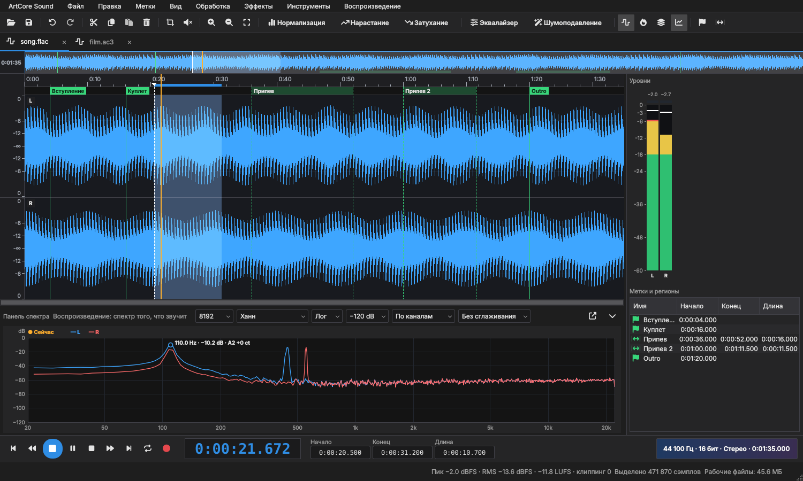
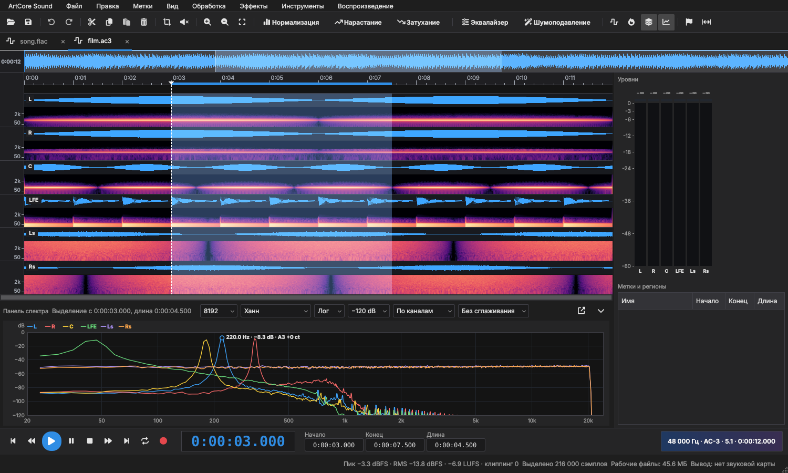
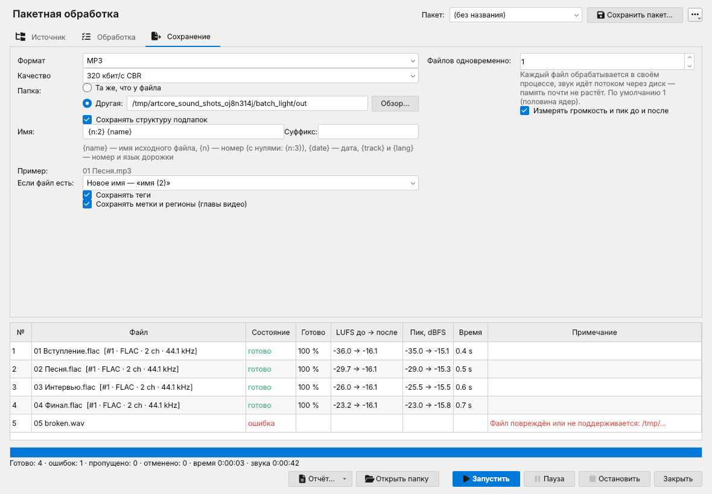
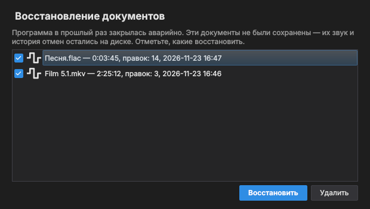

# ArtCore Sound

Аудиоредактор для Windows в духе Sound Forge: волна по каналам до 5.1 и 7.1, правка с неограниченной отменой, обработка, эффекты с предпрослушиванием, анализ, спектр и спектрограмма, метки и регионы, запись и пакетная обработка. Шестая программа семейства ArtCore — рядом с [ArtCore Convert](https://github.com/Ruf790/artcore-convert), [ArtCore Player](https://github.com/Ruf790/artcore-player), [ArtCore Music](https://github.com/Ruf790/artcore-music), ArtCore Client и ArtCore Music Remote.

*An audio editor for Windows in the spirit of Sound Forge. [English below](#english).*



## Возможности

### Файлы
- **Открытие** через FFmpeg: WAV, FLAC, MP3, AAC / M4A, AC-3, E-AC-3, DTS, TrueHD, Opus, OGG, WMA, APE, WavPack, ALAC и звук из видео (MKV, MP4, AVI, TS, M2TS, MOV …). В файле с несколькими дорожками программа спрашивает, какую открыть (кодек, каналы, язык, название). Файлы и папки можно перетащить в окно, несколько файлов открываются вкладками. «Открыть с помощью → ArtCore Sound» в Проводнике для всех этих форматов.
- **Сохранение:** WAV 16 / 24 / 32 бит float (больше 4 ГБ — RF64), FLAC 16 / 24 бит, MP3 (CBR, VBR V0 / V2), AAC (M4A), Opus, AC-3. «Сохранить» пишет в тот формат, что был открыт; для звука из видео и DTS спрашивает. «Сохранить выделение как…», «Сохранить регионы как отдельные файлы…». 16 бит — с дизерингом; MP3 сводится в стерео, AC-3 — в 5.1, частота подгоняется под формат (диалог об этом пишет). Теги, метки и главы переносятся. Запись идёт через временный файл — старый файл цел, если что-то пошло не так.

### Волна и правка
- **Волна:** каналы отдельными дорожками (моно, стерео, 5.1, 7.1 — с подписями L R C LFE Ls Rs), масштаб от всего файла до отдельных сэмплов (точки и стебли), линейка времени, шкала dB, обзорная полоса всего файла, отметки клиппинга. На экранах 125 / 150 % волна рисуется с колонкой на каждый физический пиксель.
- **Мышь и клавиши:** щелчок — курсор, протяжка — выделение (с автопрокруткой), Shift+щелчок — расширить, двойной щелчок — всё; колесо — прокрутка, Ctrl+колесо — масштаб у мыши; поля «Начало / Конец / Длина» редактируются (`1:02.5`, `62.5`, `48000 smp`). Полный список — в окне «Горячие клавиши» (F1) и [ниже](#горячие-клавиши).
- **Правка:** вырезать, копировать, вставить (поверх выделения или в курсор), вставить как новый файл, удалить, заменить тишиной, вставить тишину, обрезать по выделению. Вставка из файла с другой частотой или числом каналов переводится через FFmpeg (soxr).
- **Отмена и повтор без ограничений**, список «История правок» с переходом на любой шаг. Изменения хранятся на диске: вырезать / вставить / удалить не копируют звук, обработка записывает только изменённый кусок. Когда ветка «Повторить» отбрасывается новой правкой, её файлы сразу удаляются; если для длинной операции не хватает места, программа сама забывает шаги «Повторить» и скажет об этом.

### Обработка и эффекты
- **Обработка** (выделения или всего файла): громкость; нормализация по пику (sample или true peak) и по громкости EBU R128 — цели −23 / −16 / −14 LUFS или своя, с потолком true peak; нарастание и затухание (линейное, быстрое, медленное, S-образное), реверс, инверсия, DC offset; обрезка тишины в начале и конце; частота дискретизации, каналы (моно / стерео / 5.1), стерео → моно (смешать / левый / правый), моно → стерео.
- **Эффекты с предпрослушиванием:** «Прослушать» играет выделение по кругу через эффект, ползунки меняют звук на ходу, «Обход» сравнивает с исходным, индикаторы показывают обработанный звук. Пресеты встроенные и свои. Любое число каналов, фильм 2–3 ч в 5.1 обрабатывается кусками без роста памяти.
  - **Параметрический эквалайзер** (7 полос, график с точками, которые тянутся мышью) и **графический** (10 октавных полос).
  - **Компрессор** (порог, степень, мягкое колено, атака, восстановление, связь каналов) и **лимитер** (потолок в том числе по true peak, упреждение).
  - **Задержка** (мс или доли такта по BPM, пинг-понг, фильтры в петле) и **реверберация** (сеть из 8 линий задержки, точное RT60) — с «Оставить хвост».
  - **Темп и тон** через Rubber Band с сохранением формант.
  - **Шумоподавление** по образцу шума (спектральный гейт; режим «слушать удаляемый шум»). Образец сохраняется в файл (`.acnoise`) и загружается — для пакета и следующих сеансов. **Удаление щелчков** — поиск по ошибке AR-предсказания и AR-интерполяция, щелчки отмечаются на волне до применения.

### Анализ
- В строке состояния — пик, RMS, громкость (LUFS) и клиппинг выделения или всего файла (считается в фоне). «Инструменты → Статистика» (Ctrl+I): по каналам и общая — пик, true peak (4×), минимум и максимум, RMS, DC, клиппинг; громкость по ITU-R BS.1770-4 / EBU R128 — integrated, LRA, максимум momentary и short-term (сверено с `ffmpeg -af ebur128`, ≤ 0.1 LU).
- **Спектр:** панель внизу (F6) — спектр выделения или живой спектр того, что играет; большое окно (Ctrl+Shift+F) — метод Уэлча по всему выделению, FFT 512…65536, окна Ханна / Блэкмана-Харриса / flat-top, лин / лог, сглаживание 1/3 и 1/6 октавы, частота, уровень и нота под мышью, CSV.
- **Спектрограмма:** вид «Волна / Спектрограмма / Волна + спектрограмма» (Alt+1…3, F7) — тайлами в фоне с кэшем, шкала лин / лог / мел, палитры для обеих тем.

### Метки, регионы, запись
- **Метки и регионы** (M, R): флажки на волне тянутся мышью, список справа, Ctrl+← / →; входят в отмену и сдвигаются при правках. Сохраняются в WAV (`cue` + `LIST/adtl`, как Sound Forge), FLAC / Opus (CHAPTER, CUESHEET), MP3 / M4A (главы); главы MKV / MP4 открываются как регионы. Экспорт и импорт — CSV, .cue, метки Audacity.
- **Запись** (Ctrl+R) со входа WASAPI: индикаторы до записи, пауза, метки, предзапись, старт по уровню, запас диска; поток идёт прямо на диск.
- **Воспроизведение** через WASAPI — 5.1 играет как 5.1; бегущий курсор, по выделению, по кругу; индикаторы по каналам с удержанием пика.
- **Громкость прослушивания (2.0):** ползунок с динамиком на транспорте (колесо мыши — по 1 dB, щелчок по динамику — без звука), Ctrl+Alt+↑ / ↓ / M и пункты в меню «Воспроизведение». Меняет только то, что слышно — воспроизведение, предпрослушивание эффектов, прослушивание входа в окне записи, — плавно и на ходу; файл, сохранение и индикаторы (честный уровень файла) не меняются. Запоминается между запусками. В окне записи — галочка «Слушать вход».

### Пакетная обработка (новое в 1.0)


«Инструменты → Пакетная обработка…» (Ctrl+B) — отдельное окно, редактор при этом остаётся доступен.
- **Источник:** папка (с подпапками или без, фильтр расширений) или список файлов (перетаскиванием файлов и папок). Для видео — какую дорожку брать: по умолчанию, по языку (`rus, ru`) или все, каждую в свой файл.
- **Цепочка шагов** — всё из меню «Обработка» и «Эффекты»: громкость, нормализация (LUFS с потолком true peak, пик, true peak), DC offset, обрезка тишины, нарастание и затухание по краям (в мс), каналы, частота, эквалайзеры, компрессор, лимитер, задержка, реверберация, темп и тон, шумоподавление по файлу образца шума, удаление щелчков. Шаги добавляются, удаляются, переставляются (кнопками или перетаскиванием), включаются галочкой. Параметры — в тех же окнах эффектов с пресетами, а предпрослушивание идёт по первым 30 секундам первого файла.
- **Сохранение:** формат и качество как в «Сохранить как» (или «как у исходника»); папка та же или другая с сохранением структуры подпапок; имя по шаблону `{name}`, `{n}` / `{n:3}`, `{date}`, `{track}`, `{lang}` плюс суффикс (пример имени показывается сразу); если файл есть — новое имя «имя (2)», пропустить или заменить; теги и метки сохраняются.
- **Пакеты** (источник + цепочка + сохранение) сохраняются как пресеты (JSON, `.acbatch`) и открываются из файла.
- **Выполнение:** в фоне, без вкладок; несколько файлов одновременно — каждый в своём процессе (по умолчанию половина ядер), звук идёт потоком через диск, память почти не растёт, а место на диске резервируется под каждый файл. Прогресс по файлу и общий с оценкой оставшегося времени, пауза, остановка — недописанные файлы удаляются. Битый файл не останавливает пакет. Журнал по каждому файлу: готово / ошибка (понятным языком), LUFS и пик до и после, время; итог; отчёт в CSV (для Excel) или текстом; «Открыть папку».

### Надёжность (новое в 1.0)
- **Восстановление после сбоя.** Звук документа и так на диске, поэтому программа ведёт журнал таблицы кусков, истории отмен, меток и путей (`doc.json` в рабочей папке, атомарно). Если программа упала или её закрыли принудительно, при следующем запуске она предложит восстановить несохранённые документы — со всей историей отмен.
- **Необработанные ошибки** пишутся в лог (`%APPDATA%\ArtCoreSound\crash`: версия, Windows, трассировка, последние действия), а окно «Произошла ошибка» даёт «Скопировать отчёт». Падения внутри библиотек ловит faulthandler.
- **Нехватка места посреди операции:** понятное сообщение, документ не меняется, недописанные рабочие и выходные файлы удаляются.
- Ошибки — человеческим языком: «нет доступа (файл занят)», «файл повреждён», «слишком длинный путь». Длинные пути (больше 260 символов) и имена с кириллицей поддерживаются.

### Длинные файлы
Звук держится на диске (memmap float32), пики построены по уровням заранее, поэтому фильм 2–3 ч в 5.1 открывается, рисуется, правится и обрабатывается без роста памяти. Проверка — `tools/stress_long.py` (фильм 2,5 ч 5.1 с AC-3, E-AC-3 и DTS; в CI — отдельная задача по кнопке):

<!-- stress -->
Фильм 2 ч 30 мин, 5.1, 48 кГц (MKV: видео, AC-3 640k, E-AC-3, DTS, 15 глав) на виртуальной машине с 2 ядрами (Linux; на обычном ПК быстрее):

| | Время | Память процесса (своя) |
|---|---|---|
| Открыть AC-3 / E-AC-3 / DTS (декодирование + пики) | 39 / 43 / 73 с | 126–135 МБ |
| Рабочие файлы одной дорожки | 9,8 ГБ (float32 + пики) | |
| Волна: прокрутка (весь фильм / 10 мин / 10 с на экране), масштаб | 436 / 76 / 29 кадр/с, масштаб 99 кадр/с | |
| Спектрограмма: новый вид целиком (весь фильм / 10 мин / 10 с) | 1,5 / 2,7 / 0,4 с, потом 260–490 кадр/с | |
| Вырезать 30 мин / вставить / отменить / удалить с 200 метками | < 1 мс | |
| LUFS + LRA + true peak всего фильма | 50 с (182× реального времени) | |
| Нормализация до −23 LUFS (два прохода) | 99 с (91×) | 219 МБ |
| Лимитер с true peak / шумоподавление по всему фильму | 192 с (47×) / 361 с (25×) | 235 / 247 МБ |
| Сохранить FLAC 24 бит (4,5 ГБ, главы) / AC-3 640k | 64 с (141×) / 82 с (110×) | |
| Закрыть: рабочие файлы удалены, место вернулось | 4 с | |

«Своя» память — без страниц отображённых звуковых файлов (их Windows отдаёт по первому требованию, это кэш, а не память программы). Полный отчёт с RSS — в артефактах задачи `stress` в CI.
<!-- /stress -->

### Оформление
Как у ArtCore Convert: тёмная и светлая тема (или как в Windows), классический или современный стиль, иконки Font Awesome, интерфейс на русском и английском. Окно запоминает панели, режим вида, разделители, размеры диалогов и последние настройки. Автообновление через GitHub Releases.

## Горячие клавиши

<!-- hotkeys:ru -->
| Команда | Клавиши |
|---|---|
| **ArtCore Sound** | |
| Настройки | Ctrl+, |
| Горячие клавиши | F1 |
| Выход | Ctrl+Q |
| **Файл** | |
| Открыть | Ctrl+O |
| Сохранить | Ctrl+S |
| Сохранить как | Ctrl+Shift+S |
| Вернуть в видео | Ctrl+Shift+E |
| Закрыть | Ctrl+W |
| Закрыть все | Ctrl+Shift+W |
| **Правка** | |
| Отменить | Ctrl+Z |
| Повторить | Ctrl+Y / Ctrl+Shift+Z |
| Вырезать | Ctrl+X |
| Копировать | Ctrl+C |
| Вставить | Ctrl+V |
| Вставить как новый файл | Ctrl+E |
| Удалить | Del |
| Обрезать по выделению | Ctrl+T |
| Заменить тишиной | Ctrl+L |
| Выделить всё | Ctrl+A |
| Снять выделение | Esc |
| Выделить до начала | Shift+Home |
| Выделить до конца | Shift+End |
| **Метки** | |
| Добавить метку | M |
| Регион из выделения | R |
| Предыдущая метка | Ctrl+← |
| Следующая метка | Ctrl+→ |
| **Вид** | |
| Крупнее | ↑ / Ctrl+= |
| Мельче | ↓ / Ctrl+- |
| Весь файл | Ctrl+↑ |
| Выделение во весь экран | Ctrl+↓ |
| До сэмплов (1:1) | Ctrl+Shift+↑ |
| Вид документа → Волна | Alt+1 |
| Вид документа → Спектрограмма | Alt+2 |
| Вид документа → Волна + спектрограмма | Alt+3 |
| Панель спектра | F6 |
| В начало | Home |
| В конец | End |
| Назад | ← |
| Вперёд | → |
| **Инструменты** | |
| Статистика | Ctrl+I |
| Спектр | Ctrl+Shift+F |
| Спектрограмма вкл / выкл | F7 |
| Пакетная обработка | Ctrl+B |
| **Воспроизведение** | |
| Воспроизвести | Пробел |
| Воспроизвести весь файл | Shift+Пробел |
| Пауза | Ctrl+Пробел |
| По кругу | Q |
| Запись | Ctrl+R |
| Громче | Ctrl+Alt+↑ |
| Тише | Ctrl+Alt+↓ |
| Без звука | Ctrl+Alt+M |
| **Мышь в окне волны** | |
| Выделить участок | Перетащить |
| Расширить выделение до точки | Shift+щелчок |
| Выделить весь файл | Двойной щелчок |
| Прокрутка по времени | Колесо |
| Масштаб у курсора мыши | Ctrl+колесо |
| Передвинуть метку или край региона | Перетащить флажок |
| Переименовать метку | Двойной щелчок по флажку |
| Перейти к месту файла | Щелчок по обзору вверху |
| Открыть файлы | Перетащить в окно |
<!-- /hotkeys:ru -->

## Скриншоты

| | |
|---|---|
|  |  |
|  |  |
|  |  |
|  | |

## Установка

Скачайте `ArtCoreSound-Setup-X.Y.Z.exe` в [Releases](https://github.com/Ruf790/artcore-sound/releases) — FFmpeg уже внутри. Есть переносная версия (`ArtCoreSound-portable.zip`: настройки в папке `Data` рядом с программой). Windows 10 / 11, 64 бит.

## Сборка

```
build.bat
```

Нужны Python 3.12 / 3.13 (64 бит) и Inno Setup 6.3+. Скрипт ставит зависимости, скачивает FFmpeg (BtbN, GPL), собирает exe (PyInstaller) и установщик. Тесты: `python -m pytest tests` (нужен ffmpeg в PATH). Скриншоты: `python tools/screenshots.py <папка>`. Проверка на длинном фильме: `python tools/stress_long.py <папка> --minutes 150 --dts`. Таблица клавиш для README: `python tools/hotkeys_md.py --readme`.

## English

An audio editor for Windows in the spirit of Sound Forge.

- **Files:** opens anything FFmpeg reads, sound from video included (a dialog picks the track); saves WAV 16 / 24 / 32 float (RF64 past 4 GB), FLAC, MP3, AAC, Opus and AC-3 with tags, markers and chapters, through a temporary file. «Open with» for every supported format.
- **Waveform and editing:** a lane per channel up to 7.1, zoom from the whole file to single samples (a column per device pixel at 125 / 150 %), an overview strip; cut, copy, paste, delete, silence, trim; unlimited undo kept on disk, with an undo history list. A redo branch that an edit throws away frees its files at once; short of disk space before a long job, the program forgets the redo steps itself and says so.
- **Processing and effects** with a live preview (loop, sliders heard on the fly, bypass, presets): volume, peak / true-peak and EBU R128 normalization with a true-peak ceiling, fades, reverse, invert, DC offset, trimming silence, sample rate and channels; a parametric and a graphic EQ, compressor, look-ahead limiter with a true-peak ceiling, delay, reverb, tempo and pitch (Rubber Band), noise reduction by a noise sample — the sample saved to and loaded from a file (`.acnoise`) — and click removal.
- **Analysis:** peak, RMS, LUFS and clipping in the status bar; Statistics per channel (BS.1770-4, matching ffmpeg's ebur128 within 0.1 LU); a spectrum panel and window; a spectrogram view.
- **Markers and regions** kept through edits and saved in WAV / FLAC / Opus / MP3 / M4A; film chapters open as regions. **Recording** from a WASAPI input; **playback** through WASAPI, 5.1 as 5.1.
- **Listening volume (2.0):** a speaker and a slider on the transport (mouse wheel 1 dB a step, a click on the speaker mutes), Ctrl+Alt+↑ / ↓ / M and the Transport menu. It changes only what you hear — playback, effect preview, input monitoring in the Record window («Listen to the input») — smoothly and on the fly; never the file, saving or the meters. Kept between runs.
- **Batch processing (new in 1.0)** — Tools → Batch processing (Ctrl+B): a folder (with subfolders, an extension filter) or a list of files (drag and drop), which track of a video (the default, by language, all); a chain of any Process and Effects steps — added, removed, reordered, switched on and off, set in the same effect windows with presets and a preview of the first 30 s of the first file; the output format and quality (or «as the source»), the same or another folder keeping the subfolders, a name template (`{name}`, `{n}`, `{n:3}`, `{date}`, `{track}`, `{lang}`, a suffix), skip / replace / new name for existing files, tags and markers kept; batches saved as presets (`.acbatch`). It runs in the background in worker processes (half the cores by default), streaming through the disk with the disk space reserved per file; per-file and overall progress, pause, stop (unfinished files removed); a broken file does not stop the batch; a log per file (done / error in plain words, LUFS and peak before and after, time), a summary, a CSV or text report.
- **Robustness (new in 1.0):** a journal of every document's piece table, undo history and markers — after a crash the next start offers the unsaved documents back with their history; unhandled errors are logged (with the last actions) and shown with «Copy the report»; a full disk mid-operation gives a clear message, leaves the document as it was and removes the partial files; errors in plain words; long paths and Cyrillic names.
- **Long files:** a 2–3 h 5.1 film opens, draws, edits and processes from disk without memory growth — see `tools/stress_long.py` (a CI job run by hand).
- Dark and light themes, a classic and a modern look, Russian and English; the window remembers its panels, view, splitters, dialog sizes and last settings; automatic updates through GitHub Releases.

### Hotkeys

<!-- hotkeys:en -->
| Command | Keys |
|---|---|
| **ArtCore Sound** | |
| Settings | Ctrl+, |
| Hotkeys | F1 |
| Quit | Ctrl+Q |
| **File** | |
| Open | Ctrl+O |
| Save | Ctrl+S |
| Save as | Ctrl+Shift+S |
| Return to video | Ctrl+Shift+E |
| Close | Ctrl+W |
| Close all | Ctrl+Shift+W |
| **Edit** | |
| Undo | Ctrl+Z |
| Redo | Ctrl+Y / Ctrl+Shift+Z |
| Cut | Ctrl+X |
| Copy | Ctrl+C |
| Paste | Ctrl+V |
| Paste as a new file | Ctrl+E |
| Delete | Del |
| Trim to the selection | Ctrl+T |
| Silence | Ctrl+L |
| Select all | Ctrl+A |
| Select none | Esc |
| Select to the start | Shift+Home |
| Select to the end | Shift+End |
| **Markers** | |
| Add a marker | M |
| A region of the selection | R |
| Previous marker | Ctrl+← |
| Next marker | Ctrl+→ |
| **View** | |
| Zoom in | ↑ / Ctrl+= |
| Zoom out | ↓ / Ctrl+- |
| Whole file | Ctrl+↑ |
| Zoom to the selection | Ctrl+↓ |
| Down to samples (1:1) | Ctrl+Shift+↑ |
| Document view → Waveform | Alt+1 |
| Document view → Spectrogram | Alt+2 |
| Document view → Waveform + spectrogram | Alt+3 |
| Spectrum panel | F6 |
| Go to the start | Home |
| Go to the end | End |
| Rewind | ← |
| Forward | → |
| **Tools** | |
| Statistics | Ctrl+I |
| Spectrum | Ctrl+Shift+F |
| Spectrogram on / off | F7 |
| Batch processing | Ctrl+B |
| **Transport** | |
| Play | Space |
| Play the whole file | Shift+Space |
| Pause | Ctrl+Space |
| Loop | Q |
| Record | Ctrl+R |
| Louder | Ctrl+Alt+↑ |
| Quieter | Ctrl+Alt+↓ |
| Mute | Ctrl+Alt+M |
| **The mouse in the waveform** | |
| Select a stretch | Drag |
| Extend the selection to a point | Shift+click |
| Select the whole file | Double-click |
| Scroll in time | Wheel |
| Zoom about the mouse | Ctrl+wheel |
| Move a marker or a region's edge | Drag its flag |
| Rename a marker | Double-click its flag |
| Go to a place of the file | Click the overview at the top |
| Open files | Drop them on the window |
<!-- /hotkeys:en -->

License: GNU GPL v3. Third-party components: [THIRD-PARTY.md](THIRD-PARTY.md).
